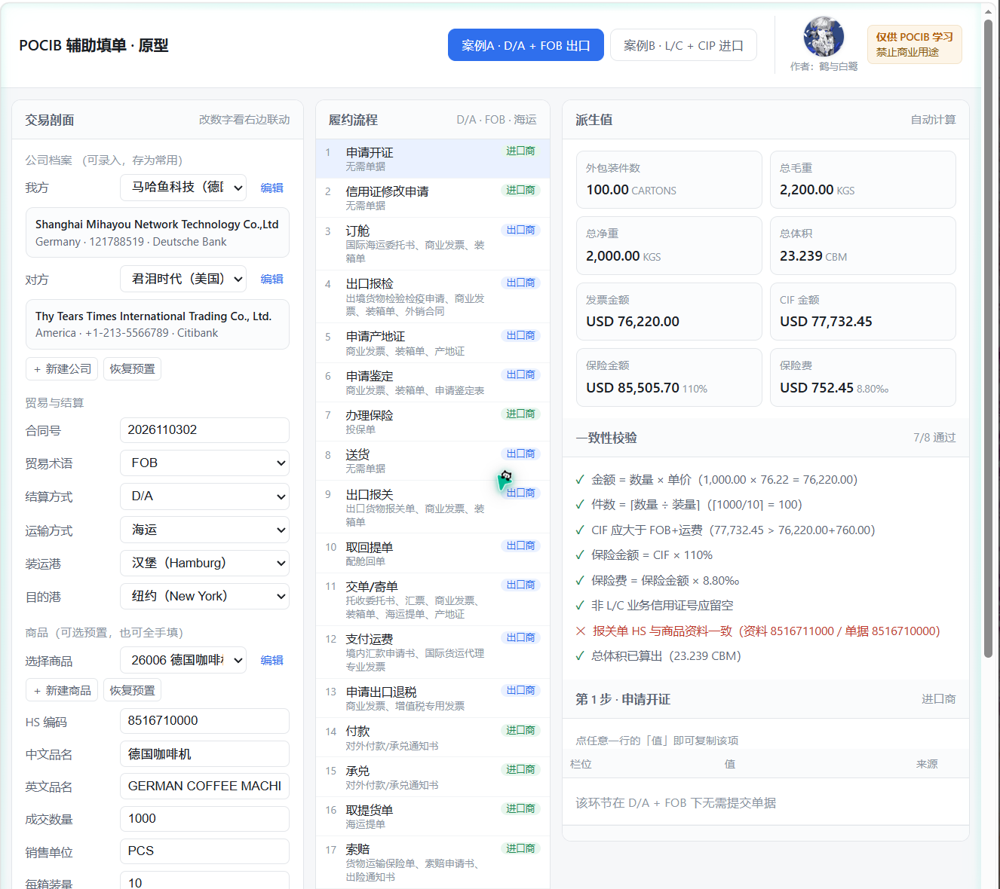

# POCIB 填单助手

> 一个单文件网页工具，帮你在 POCIB 国际贸易实训中把 21 个环节、20 多份单据的字段自动算好、填好、校验好，并生成全套外贸函电。

顶部两个模式，共用同一份交易数据：

- **单据填写** —— 21 环节流程、单据字段、派生计算、一致性校验
- **函电与预算** —— 9 封外贸函电（中/英/对照）、集装箱运费（内置 90 条海运 + 90 条空运运价）、进出口预算

页面底部另有 **选品参考**：比较出口国工厂价与进口国市场价，按价差排序给推荐商品。



## 为什么需要它

POCIB 一门课下来要填几百个栏位，其中真正需要动脑子的不到一成，其余全是从同一批数据里反复抄：公司名、地址、商品描述、件数、毛净重、体积、金额大写……

这个工具的思路是：**你只填一次源头数据，剩下的交给程序算和拼。**

一份数据进来，程序负责：

- 按「结算方式 × 贸易术语」列出 21 个环节该交哪些单据、由谁交
- 算出外包装件数、总毛净重、总体积、发票金额、CIF、保险金额、保险费、金额大写
- 把每个栏位的值拼好，点一下就复制
- 用 8 条规则做一致性校验，对不上的地方标红

## 快速开始

**方式一（最省事）**：到 [Releases](https://gitee.com/crane-and-egret/pocib-form-helper/releases) 页面下载压缩包，解压后双击里面的 html 即可。不用安装、不用联网。

两个下载包按需选：

| 包 | 大小 | 适合谁 |
|---|---|---|
| `POCIB填单助手.zip` | 约 140 KB | 只要填单 + 自己能装 Python（想用截图识别时） |
| `POCIB填单助手-绿色版.zip` | 约 92 MB | 想连截图识别一起用、且不想装任何东西——自带 Python 运行时和 PP-OCR 模型，解压即用 |

绿色版为什么这么大：里面塞了完整的推理栈（`cv2.pyd` 74MB + onnxruntime 47MB + numpy 53MB + 3.7MB 标准库），换来的是一台没装过 Python 的电脑也能直接识别。

**方式二**：直接用仓库里的 `dist/POCIB填单助手.html`，双击用浏览器打开。

**方式三**：
```bash
git clone https://gitee.com/crane-and-egret/pocib-form-helper.git
```

推荐用 Edge 或 Chrome。

## 界面怎么用

### 模式一：单据填写

三栏布局：

**左栏 · 交易剖面** —— 你填数据的地方

| 区域 | 说明 |
|---|---|
| 公司档案 | 我方 / 对方各一份，23 个栏位跟 POCIB 注册公司页一一对应。可以「另存为新公司」存起来，下次直接下拉选 |
| 贸易与结算 | 合同号、贸易术语（8 种）、结算方式（4 种）、支付条款（可手改，如 `40% IN ADVANCE AND 60% …`）、运输方式、装卸港（10 个港口下拉）。**装卸港跟着公司走**：换我方 / 对方公司就按该公司所在国重选港口（POCIB 每国只有一个港），出口方国家的港 → 装运港、进口方国家的港 → 目的港；手填的「其他港口」在切案例时不被覆盖。换结算方式时支付条款自动换成该方式的默认写法 |
| 商品 | 可下拉选预置商品一键带入，也可以全部手填。商品同样可以存为常用 |
| 数量单价 | 改数字，右栏实时联动 |

**中栏 · 履约流程** —— 21 个环节，每步显示该交什么单、谁去交。第 7 步「办理保险」的执行方会随术语自动切换（CIF/CIP 出口商投，FOB/FCA/CFR/CPT 进口商投）。

**下方 · 选品参考 / 海关税率查询** —— 选品按进出口国的工厂价与市场价算价差；税率查询填 HS 编码或品名就能查到税率，点「填入商品」直接换掉当前商品，第 20 步的缴款书税额跟着重算。

**右栏 · 派生值 / 校验 / 单据字段** —— 点中栏任一环节，这里显示该单据的每个栏位该填什么、值是从哪来的（自动算的 / 公司档案带的 / 银行表带的 / 需要你自己确认的）。

### 模式二：函电与预算

切到「函电与预算」后，右上角有一个 **「实时同步」开关**（默认开着）：开着时主面板与函电共用一套数据，双方公司、商品、数量单价、术语、港口、支付方式都实时跟过去，不用点按钮；关掉就变成各改各的，需要时点旁边的「同步一次」推一次。

带入的内容不限于抬头：**商品运费计算** 的包装数量（件数）、单包装毛重、单包装体积取自商品档案，带入后直接算好总毛重、总体积与柜数；**进出口预算** 的工厂采购价与进口国市场价取自内置五国价格表（与「选品参考」同源）、运费按贸易术语方向填（FOB/FCA/FAS 填进口运费，其余填出口运费）。之后在主面板改任何数字，只要光标不在函电里，函电那边会跟着变（400ms 防抖）。

运费单价（20普/40普/40普高、冻柜、拼箱 MTQ/TNE、空运 Minimum/Normal/45/100/300 各档）**已内置 10 个港口两两之间的 90 条海运 + 90 条空运运价**，取自 POCIB 国际货运公司「航程及运费查询」。**在函电里直接换装运港 / 卸货港，单价按新航线当场换掉，柜数、总毛重、总体积与最终运费一起重算**，不需要点任何按钮（原来的「计算商品运费」「一键填入运费」都去掉了）；切海运 / 空运、换普柜 / 冻柜、改件数毛重体积、手改单价，同样即时重算。运费算完自动按贸易术语方向写进预算的「出口运费 / 进口运费」，预算表跟着重算。

函电里改港口或运输方式，会回传给主面板（实时同步开着时），左栏运费、单据里的港口一起跟着变，两边不会各说各的。

**数量 / 单价（成交价）是双向的**：主面板「单价」→ 函电「商品与价格」单价 + 预算「成交单价」；反过来在函电里改单价、预算成交单价、数量或合同金额（按金额÷数量反推单价），也会回传主面板并重算发票金额、CIF、柜数与单据，不会再出现「在函电里改完价、切回去又被旧值盖掉」。程序自己推过去的值带 `__frmParent` 标记，不回声，所以两边不会互相覆盖；实时同步关着时不采纳，函电会提示「这次改动只留在函电里」。

**港口按公司所在国自动对上**：函电里的装运港 / 卸货港取出口公司、进口公司所在国的港口，预算区的进出口国与之一致（汇率、工厂价/市场价、报关费、商检、退税都按这个国别取），不再停在模板默认值上；以前那个写死的「南非 Cape Town」默认已去掉，函电打开时若还没拿到数据会显示「（按出口公司所在国自动）」并主动向主程序要一次。在函电里手改港口后，以你选的为准（并回传主程序改交易）。

模块内含三块：

1. **函电生成** —— 一次生成 9 封（建交、询盘、发盘、还盘、接受、签约、催证、装运通知、催款等），可切换英文 / 中文 / 中英对照，点目录跳转，一键复制
2. **商品运费** —— 按普柜 / 冻柜 / 空运三套价目，用包装数量、毛重、体积算出总运费；数量、毛重、体积带入即填，改任一项结果即时重算
3. **进出口预算** —— 按 FOB / CPT / CIF 三种方式输出出口、进口两套预算表。进口税率、消费税率、增值税率、退税率**跟着当前商品的 HS 编码走**（读的是主程序那份海关税则，不另存）：换商品自动重填，消费税从价与增值税会同步到出口栏；手改过的格子不再被覆盖，换商品才重新按税则填，进口信息下方有一行说明写着税率取自哪条税则。

**费用口径按 POCIB 百科逐条核对过**（《出口报价》《进口核算》与三个报价核算实例）：

| 项目 | 口径 | 说明 |
|---|---|---|
| 出口退税收入 | 收购价 ÷ (1 + 增值税率) × 出口退税率 | 各国都退，退税率取商品 HS 的「出口退税」列；退税率 0 的商品（如雪茄）退税就是 0 |
| 实际采购成本 A | 收购价 − 出口退税收入 | |
| 商检费（出口） | 对外报价 × 0.25% | **只在监管条件含 B，或合同 DOCUMENTS 选了品质/健康/数量/植物检疫证书时收**；否则为 0 |
| 商检费（进口） | 成交价 × 0.25% | **只在监管条件含 A 时收**；没有 A 为 0 |
| 报关费 | 出口国 / 进口国本币固定值 | 海关「费用查询」EUR9/次，按各国本币折算 |
| 出口税 | 0 | POCIB 商品一律没有出口税 |
| 银行费用 | 成交金额 × 费率，低于最低取最低 | 出口 L/C 0.13%、押汇 2%、DA/DP 与 T/T 0.1%；进口 L/C = 开证费 + 0.13%，其余 0.1%。最低手续费 EUR19（押汇 EUR190、开证 EUR29/笔）按各国本币折算；T/T 定金与尾款分两次各判各收 |
| 其他 | 自动汇总：产地证 + 商检证书 + DHL 寄单费 + 运输条件鉴定 | 见下「其他费用怎么来的」；手改就按手改的，清空恢复自动 |
| 出口总成本 C | A + B | 任何术语都要填，FOB 表底就是它 |
| CFR/CPT 成本 | C + 出口运费 | |
| 投保金额（出口） | 对外报价 × 投保加成 | 加成 110/120/130% |
| 总保费率 | 各险别之和 | 战争险 + 罢工险只算一次（0.8‰）；一切险已含一般附加险，不另加 |
| CIF/CIP 成本 | C + F + I | |
| DAP / DPU 成本 | C + F + I + 进口国内陆运费 + 目的地卸货费 | 陆运 USD300、卸货 USD20（POCIB 统一价），折出口国本币计入，预算表单列两行 |
| 进口关税 | CIF/CIP 成交价 × 优惠税率 | 基数是**含保费的 CIF 价**，不是 FOB |
| 完税成本 | CIF 成交价 + 进口关税 | |
| 消费税 | 完税成本 × 率 ÷ (1 − 率) | 从价；从量商品按「数量 × 单位税额」 |
| 增值税 | (完税成本 + 消费税) × 增值税率 | |
| 银行费用（进口） | 开证费 + 成交金额 × 付款费率 | 开证费只在 L/C；付款费率 L/C 0.13%、D/P、D/A、T/T 0.1%，同样取最低 |
| 总成本（进口） | 完税成本 + 国内费用 + 银行费用 | |
| 参考报价 | D(1+n) / [1 − (1+n)(k+m+rR)] | k 报检费率、m 银行费率、r 保费率、R 加成；**触发最低手续费时换成不含 m 的公式** |

两个百科实例已写成回归断言（`scripts/test_budget.mjs`）：L/C+CFR 南非出口那笔的退税 169,115.04、国内费用 6,063.99、CFR 成本 1,321,245.70；T/T+FCA 古巴进口那笔的关税 1,196,867.08、消费税 3,366,188.67、增值税 1,215,568.13、总成本 10,577,065.64，逐项对得上。

**其他费用怎么来的**（全自动汇总，出口国本币；格子可手改，清空恢复自动）：

| 组成 | 取价 | 什么时候有 |
|---|---|---|
| 一般原产地证 / 普惠制产地证 | EUR3（预算表「常用数据」已有各国折本币值） | 一直有；进口国是美国→一般原产地证，其余→普惠制 |
| 商检证书 | 品质 10、数量/重量 4、植物检疫 4、健康 4（EUR/份） | 合同 DOCUMENTS 选了就该份收，数量与重量是同一张只收一份 |
| DHL 寄单费 | 邮局「收费标准」，按国家（USD5 / EUR2 / GBP1 / JPY662 / RUB144 / BRL12 / AUD6 / CUP6 / ZAR38 / RMB43） | 支付方式为 T/T |
| 运输条件鉴定 | 化学材料测试中心，按国家（USD173 / EUR130 / GBP86 / JPY20446 / RUB4562 / BRL358 / AUD212 / CUP185 / ZAR1217 / RMB1323） | 商品编号是 21001、40001、40002、06002（磺胺氯哒嗪钠、七号电池、锂电池、环保涂料） |

**机构价目来源**：邮局寄单费与化工鉴定费按国家不同，抓自 `institutions/company/18/S0180–S0189`、`21/S00604–S00694`（`scripts/crawl_charges.py`，`--check` 可校验代码与页面是否一致）；银行「基本费用查询」与海关「费用查询」是全系统同一张价目表（页面是 `<%=money%>` 模板，各国渲染同一组值），基准价写死在 `BANK_EUR` / `CERT_EUR`，按 `customs/EUR9` 折各国本币——和同一张「常用数据」表里的报关费、开证费口径一致。

> 函电模块以同源 iframe 方式隔离运行，与主程序的样式和脚本互不干扰。

## 内置的数据

| 数据 | 来源 | 数量 |
|---|---|---|
| 履约流程与单据清单 | POCIB 百科《各流程提交单据列表》 | 21 环节 × 4 种结算方式 |
| 单证字段与填写规则 | POCIB 百科各单证页 | 483 个字段 |
| 港口与航线 | POCIB 海运部航程查询 | 10 个港口 / 90 条航线 |
| 海关税则 | POCIB「税率查询 - 海关 CUSTOMS」 | 11,709 条 / 8,547 个编码（第 1–96 章） |
| 各国商品价格 | 客户端「国内市场」「工厂采购」截图 | 5 国 / 209 个商品 / 约 900 条价格 |
| 各国银行 | 课程资料 | 10 国各一家 |
| 邮局寄单费 / 化工鉴定费 | POCIB 邮局、化学材料测试中心「收费标准」 | 各 10 国 |
| 银行费率 / 商检证书费 / 产地证 | POCIB 银行「基本费用查询」、海关「费用查询」 | 全系统一套（EUR 计价） |

## 已实现的单据

字段级渲染（每个栏位都有值）：

- 商业发票、装箱单
- 出口 / 进口货物报关单
- 投保单
- 托收委托书、汇票
- 不可撤销信用证开证申请书
- 国际海运 / 空运委托书
- 境内汇款申请书、境外汇款申请书（T/T 付汇）
- 出境货物检验检疫申请、入境货物检验检疫申请、一般原产地证、普惠制产地证、合同

其余单据会列出字段清单与来源标注。

## 各流程该交哪些单

按 POCIB 百科《各流程提交单据列表》重排过，四个变化点容易抄错：

**交单 / 押汇（第 11 步）**

- **货物运输保险单只在 CIF / CIP 下出现**，FOB / CFR / FCA / CPT 由进口商自己投保，交单里没有保险单
- 商检证书（品质 / 健康 / 数量重量 / 植物检疫）按合同 `Document` 条款给，合同没写就不列
- 「出口押汇申请书」标「办押汇才交」——交单与押汇只能选一个，已经交单就办不了押汇
- L/C 下第一张是信用证，T/T 下没有汇票与托收委托书

**办理保险（第 7 步）**执行方随术语变：CIF/CIP 出口商投且要带商业发票；其余术语进口商投，只交投保单。

**送货 / 出口报关的《货物运输条件鉴定书》**只对 `21001 / 40001 / 40002 / 06002` 四个品目要，其他商品送货不交任何单据，报关时也不带鉴定书。

**空运与海运换一批单据名**（改「运输方式」下拉即刻生效）：

| 海运 | 空运 |
|---|---|
| 国际海运委托书 | 国际空运委托书 |
| 海运提单 | 航空运单（出口报关也要带） |
| 提货单 | 提货通知单 + 航空运单 |
| 取回提单（配舱回单） | 无此步骤 |
| 取提货单 | 无需提交单据 |

> 以前「运输方式」下拉没有写回数据，选空运后程序内部仍是海运，所以看不出差异——这次一并修了。

## 金额大写一套口径

所有单据的大写都走同一个函数 `amtWords`，不再各写各的（原先汇票与开证申请书走的是另一套，缺币种前缀、丢掉小数）：

- 整数：`USD EIGHTY NINE THOUSAND SIX HUNDRED AND FIFTEEN ONLY`
- 带小数：`USD ONE THOUSAND AND SEVEN CENTS FIFTY`（结尾不加 ONLY）
- 英文数字里的连字符去掉，`TWENTY ONE` 不写 `TWENTY-ONE`
- 前缀跟左栏「大写币种」走（USD / US DOLLARS / U.S.DOLLARS…）

发票 `SAY TOTAL`、汇票 `the sum of`、开证申请书 `Amount`、境内外汇款 `金额大写` 输出的是同一个字符串。

## 单据字段的分栏约定（v1.12）

抄单最容易错在不该合并的地方合并，这几处特意拆开：

**国际海运 / 空运委托书**

- 发货人的名称、电话、地址各占一行，不再挤成「名称　TEL xxx」
- 委托日期不给默认值——必须晚于合同签订日，自己填
- DOCUMENT 栏不自动生成发票号和装箱单号，只提示你去商业发票上找 INVOICE No.、去装箱单上找 PACKING LIST No.

**出境货物检验检疫申请**

- 联系人、联系电话分两行
- 发货人、收货人的中文名与英文名各占一行
- 启运地、到达口岸拆成两栏，取实际的装运港与目的港（原先写死成「汉堡 / 纽约」）
- 货物存放地点：海运方式参考订舱后「配舱回单」上的存放地，空运方式不填

**投保单**

- 投保人与被保险人拆成两栏：投保人是去办保险的那一方（CIF/CIP 为出口商，FOB/CFR/FCA/CPT 为进口商），被保险人固定填进口商——CIF 下出口商投保后把保单背书转让给进口商，索赔权在进口商手上
- 投保人的名称、地址 / 邮编、联系人、电话各占一行；被保险人另起名称与地址 / 邮编两行

**托收委托书**

- 委托人、付款人各自拆成「名称 / 地址 / 电话」三行，不再挤成一长串，逐栏对抄不易串行

**数量与包装件数**跟随商品档案里的中文单位（排球是「个」、罐头是「箱」），不再写死「件」「纸箱」；商品档案没有中文单位时按常见英文单位回退映射。

**出口 / 进口货物报关单**

- 商品名称下面单列「规格型号（中文）」，取商品档案的规格型号中文（发票用英文，报关单用中文）
- 「申报单位」与境内收发货人同源：公司名称 + 海关 10 位编码，不用重复填

**境外汇款申请书（T/T 付汇）**

按 POCIB 填写说明逐栏给值，付款人是进口商、收款人是出口商：

- **汇款币种及金额**：支付条款写成 `40% IN ADVANCE AND 60% …` 这种两段式时，表里直接列出「定金 40%」与「尾款 60%」两笔；单段式只列合同全额
- **定金 / 尾款算法**：定金 = 合同金额 × 百分比（先四舍五入到分），尾款 = 合同金额 − 定金（不是拿尾款比例另乘一遍，否则会差一分）
- **付款方式**：定金选「预付货款」、尾款选「货到付款」；单段式按条款里有没有 `IN ADVANCE` 判
- **现汇 / 购汇**：本笔全额走现汇，购汇填 0，现汇 + 购汇 = 汇款金额
- **日期**：取制单日期，早于合同签订日（合同号前 8 位）时改标「待确认」
- **收款人**：开户行与地址取出口商的银行表，账号取出口商档案；汇款人是进口商英文名 + 英文地址
- **外汇账号**：按汇款币种从公司档案的「多币种账号」里取；档案里没有该币种就标「待确认」并提示去「我的资金 → 账户列表」查，**不会拿别的币种账号顶替**
- **申请人姓名 / 申请人电话**分两行（姓名填汇款人公司英文名）
- **交易编码**：固定 101010（一般贸易收支）；报关单相关五栏按 POCIB 规则标「不需要填写」
- 金额大写的连字符去掉（例文写 `U.S.DOLLARS EIGHTY NINE THOUSAND SIX HUNDRED ONLY`）

**公司档案 · 多币种账号**

公司档案弹窗底部新增「多币种账号」，一个币种一行（币种下拉 16 种，来自「我的资金 → 账户列表」的常见币种），可增删：

- 本币那一行首尾相顾：打开时用「本币账号 + 币别」预填，保存时同步回「本币账号」
- 存进 `accts: {USD:"6222…", EUR:"6101…"}`，交易剖面卡片上会显示该公司已配的币种（`账户：EUR / USD`）
- 汇款类单据按单据币种自动取号，币种对不上不兜底，避免把 EUR 账号填进 USD 汇款单

**境内汇款申请书**

- 汇款币种及金额、金额大写、现汇金额、相应币种及金额四处都取左栏的「运费 USD」，改运费即时联动（原先读的是案例里写死的 `freight_amt`，改运费这单不动）
- 现汇金额与外汇账号拆成两行；购汇金额与购汇账号同样分开（默认不购汇）
- 收款人名称及地址固定为货代：`国际货运有限公司 / Two United Nations Plaza, 25th Floor, New York, NY 10017`，常驻国家随之填「美国 502」，只有账号要抄货代发票
- 申请人姓名、申请人电话分两行
- 签章拆成「申请人签章（公司）」与「申请人签章（人）」两行

**入境货物检验检疫申请**

按 POCIB 填制说明逐栏给值，共 40 栏。收货人＝进口商、发货人＝出口商，中英文各占一行：

| 栏位 | 取值 |
|---|---|
| 申请单位名称 / 登记号 / 联系人 / 电话 | 进口商档案（中文名、报检登记号、法人、电话） |
| 收货人（中文 / 英文） | 进口商中英文名 |
| 发货人（中文 / 英文） | 出口商中英文名 |
| 货物名称（中/外文） | 商品中文名 + 英文名，两行 |
| 原产国 / 贸易国别 / 启运国家 | 出口国中文国别（取自公司档案 `country_zh`） |
| 数/重量 | 合同销售数量 + 销售单位中文（`1,000 件`、`20,000 箱`） |
| 包装种类及数量 | 外包装件数 + 包装单位中文（`100 纸箱`） |
| 启运口岸 / 入境口岸 / 目的地 | 装运港、目的港的中文名（`汉堡`、`纽约`） |
| 集装箱规格、数量及号码 | 由柜型判定结果给出规格与数量，柜号提示看提货单；空运留空 |
| 随附单据 | 合同、发票、提/运单、装箱单固定勾选，合同约定单据附加勾选 |

由海关填写或 POCIB 无需填写的栏位统一标「空」：编号、许可证/审批号、卸毕日期、经停口岸、货物存放地点、用途、检验检疫费、领取证单。运输工具名称号码、提单/运单号、到货日期、索赔有效期至、特殊条款、标记及号码标「待确认」，提示去提货单、到货通知邮件或合同上抄。

港口中文名有内置对照（10 个港口），手动输入的自定义港原样显示。

## 产地证第 6–10 栏（v1.13）

普惠制 / 一般原产地证的 6–10 栏按 POCIB 填制说明成文：

| 栏位 | 填法 | 来源 |
|---|---|---|
| 6. Marks and numbers of packages | 唛头原文，没唛头填 N/M | 合同唛头，待确认 |
| 7. Number and kind of packages; description of goods | `英文大写件数（阿拉伯数字）包装种类 OF 商品名称(英文)` + 换行 + 规格型号(英文) | 自动 |
| H.S. Code（7、8 栏之间） | 商品 HS 编码 | 主体 |
| 8. Origin criterion | `"P"`（引号带上） | 常量 |
| 9. Gross weight or other quantity | 按销售单位填数量，如 `2000PCS`；以重量为销售单位的填毛重，如 `2625KGS` | 自动 |
| 10. Number and date of invoices | 不给值，提示照商业发票抄 | 待确认 |

**第 7 栏**的件数与装箱单的「外包装件数」同源（`D.packs`，进过位），单位是商品的包装单位：

```
NINETY NINE (99) CARTONS OF 24K Gold Pendant Necklace
24K Pure gold, Gold Weight: 9.50g, Length: 40CM, Packaging: 1pc/box, 10boxes/carton
```

英文大写沿用 `words()`，但去掉连字符——POCIB 例文写的是 `NINETY NINE`，不是 `NINETY-NINE`；括号内的数字不加千位分隔符。

**第 9 栏**先判断销售单位：

- 件 / 辆 / 套等非重量单位 → `数量 + 单位复数`，如 `2000PCS`、`500UNITS`
- 吨 / 千克等重量单位 → 填毛重 `2625KGS`；只有净重时填 `N.W. 500 KGS`；毛重 ≤ 1 公斤用单数 `1KG`

## 把数据带走

公司和商品存在浏览器的 localStorage 里，**不在 HTML 文件内部**，所以直接把 HTML 发给别人，对方看不到你新增的内容。

左栏「公司档案」下方有三个按钮解决这个问题：

| 按钮 | 作用 |
|---|---|
| 导出数据 | 生成 `pocib-数据包.json`，含全部公司和商品 |
| 导入数据 | 读取别人的数据包，同号覆盖、不同号追加 |
| 导出含数据HTML | 生成一个数据已内嵌的新 HTML，对方双击就能用 |

推荐第三种：对方无需任何操作，打开就是你配好的版本。

## 重量 / 体积的计算口径（v1.11）

POCIB 的商品分两种结构，重量体积的算法不一样，混用会算错。

**① 销售单位 = 包装单位**（罐头、茶叶这类食品）：数量本身就是箱数，直接乘。

```
毛重 = 数量 × 每箱毛重    净重 = 数量 × 每箱净重    体积 = 数量 × 每箱体积
```

**② 销售单位 ≠ 包装单位**（玩具、服装、按吨卖的货）：先折箱数，且**箱数要进位取整**。

```
单件净重 = 每箱净重 ÷ 单位换算
总净重   = 单件净重 × 数量
箱数     = ⌈数量 ÷ 单位换算⌉
总毛重   = 总净重 + 箱数 × (每箱毛重 − 每箱净重)
总体积   = 箱数 × 每箱体积
```

关键在毛重那一行：不足一箱的零头只算净重，不能按整箱毛重算。拿官方例 3 对一下——08001 玩具车，UNIT/CARTON，6 辆/箱，毛 23 净 21 体积 0.08052，交易 1000 辆：

| 项目 | 算法 | 结果 |
|---|---|---|
| 总净重 | 21 ÷ 6 × 1000 | 3500 KGS |
| 箱数 | ⌈1000 ÷ 6⌉ | 167 |
| 总毛重 | 3500 + 167 × (23−21) | **3834** KGS（不是 167×23 = 3841） |
| 总体积 | 167 × 0.08052 | 13.447 CBM |

单位换算小于 1 的也能算（例 5：20 MT，1 包装单位 = 0.02 销售单位 → 20 ÷ 0.02 = 1000 箱）。

判定「单位是否相同」看销售单位与包装单位的名称（CARTONS / CARTON 视为同一个），同时要求单位换算为 1。

界面上还会显示一行提示，说明这次走的是哪条口径。

## 单柜装载上限（报价数量）

左栏底部列出当前柜型下每个柜能装多少箱、折多少销售数量，用于报价核算——POCIB 建议按柜能装的最大包装数量报价，海运费最省。

```
可装箱数 = ⌊min(柜体积 ÷ 单箱体积, 柜限重 ÷ 单箱毛重)⌋
```

销售单位 ≠ 包装单位时，再乘单位换算得出可卖数量。核对官方例 2（08003，6 辆/箱，0.0576 CBM / 21 KGS）：20' 柜 572 箱 = 3432 辆，40' 柜 1163 箱 = 6978 辆。

口径自测：`node scripts/test_calc.mjs`（官方 7 个例题 + 边界用例）。

## 集装箱选型（v1.10）

填完每箱体积和毛重，「派生值」直接给出柜型和柜数，海运委托书的「柜型及数量」栏也自动成文。

| 柜型 | 限重 | 限体积 |
|---|---|---|
| 20' 普柜 | 25 TNE | 33 CBM |
| 40' 普柜 | 29 TNE | 67 CBM |
| 40' 高柜 | 29 TNE | 76 CBM |
| 20' 冻柜 | 21 TNE | 27 CBM |
| 40' 冻柜 | 26 TNE | 58 CBM |
| 40' 冻柜高 | 26 TNE | 66 CBM |

判定按三步走：**柜数最少 → 柜型种类最少 → 装载率最高**。

- 枚举 6 种柜型的全部组合（每种柜的数量上限取「单独装完所需只数」，体积与限重取大者），只留体积和重量都装得下的
- 柜数相同的，能用一种柜解决就不混装——订舱、堆场都省事
- 仍然相同的取装载率高的一档，少占舱位

**有运价时先比价**：能查到这条航线的运价，就在 20' / 40' / 40'高（冻柜同理）三种单柜型方案和拼箱之间挑运费最低的一档，柜型、装载率、运费、单据四项跟着同一个方案走——柜多不一定便宜，例如下面第二例。

两个实测例子：

| 货物 | 总体积 / 总毛重 | 结果 |
|---|---|---|
| 1000 箱咖啡机（汉堡→纽约） | 23.239 CBM / 2.20 TNE | `1×20'普柜`，装载 70.4%，运费 USD 760 |
| 20000 箱龙眼罐头（纽约→汉堡） | 225.880 CBM / 224.22 TNE | `9×20'普柜`，USD 13,311（`8×40'普柜`要 USD 15,664，柜少但更贵） |

**拼箱**：体积 ≤ 10 CBM 且毛重 ≤ 2 TNE 时提示走 LCL，托运单勾「拼箱」，同时给出整箱折算只数。

**冻柜**：勾「货物属性 → 冷藏/冷冻货」即切到 20'RF / 40'RF / 40'RQ 三种；选商品时若品名或属类含「冷冻、冷藏、水产、FROZEN」等字样会自动勾上。

算法自测：`node scripts/test_box.mjs`（直接从 `app/index.html` 抽取 `planBox` 跑 14 组用例）。

## 预计运费（v2.2）

POCIB 的运价要去「国际货运有限公司 → 海运部 / 空运部 → 常用查询 → 航程及运费查询」，一条航线点一次「详细」才看得到价。现在这些价随程序一起带走：

- **海运 90 条 + 空运 90 条**（10 个港口两两之间，双向），字段是 `20' / 40' / 40'高 / 拼箱 MTQ / 拼箱 TNE`，空运是 `Minimum / Normal / 45 / 100 / 300 / 500 / 1000`
- 左栏「运费 USD」下面一行会写清这单怎么算出来的，例如 `汉堡→纽约 海运 1×20'普柜：USD 760.00`；点「按运价表估算」可随时重算，手改过运费就不再自动覆盖

口径按 POCIB 百科《如何计算运费》：

```
海运整箱：运费 = 所选柜型的单价 × 只数
海运拼箱：max(MTQ × 总体积, TNE × 总吨数)
空运：    计费重量 = max(总毛重 KG, 总体积 × 167)
          < 45KG 用 Normal，45–100 / 100–300 / ≥300 落到对应档
          算出来低于 Minimum 的按 Minimum 收
```

和预算的联动是同一条链：左栏运费 → 单据（发票 / 提单 / 境内外汇款申请书）→ 函电「商品运费计算」的单价栏（20普/40普/40普高/冻柜/拼箱/空运各档）→ 进出口预算的运费项。所以换起运港、切海运 / 空运、勾冷藏，预算里的运费会跟着变，不用再去运价页抄数。

数据是抓的，不是手抄：

```
python scripts/crawl_freight.py      # 遍历 10 个国家 → 航线列表 → 每条「详细」，写 data/freight.json
python scripts/gen_freight.py        # 压成 FREIGHT 常量内嵌进 app/index.html（--check 只校验不写）
node scripts/test_freight.mjs        # 21 项：对照百科例题（5600/7071、139/153、37.3、33.3）与整箱/拼箱/空运档位
```

> 运价是 POCIB 服务器上的固定表，换服务器地址时给 `crawl_freight.py` 加 `--base http://新地址:端口` 重抓即可。

## 选品比价（v2.0）

POCIB 开局要先挑一门生意：同一批货，在 A 国工厂买、卖到 B 国市场，赚多少差得很多。页面底部新增「选品参考」，把这件事算给你看。

```
出口国工厂价 × 汇率 → USD 成本
进口国市场价 × 汇率 → USD 售价
价差 = 售价 − 成本        毛利率 = 价差 ÷ 成本
```

- 选出口国 → 进口国，列出两者都有数据的商品，默认按**毛利率降序**，前三名标「推荐」
- 「跟随合同」按合同的**装运港所在国**当出口国、**目的港所在国**当进口国，切案例、改港口会自动跟
- 汇率可改（默认 1 USD = 6.80 RMB / 0.91 EUR / 1.11 AUD / 33.3 RUB），改完存本地，下次仍在
- 只算价差，**未计关税、增值税、运费、保险**——纯选品参考

内置五国数据，由 12 张客户端截图 OCR 而来：

| 国家 | 国内市场 | 工厂采购 |
|---|---|---|
| 俄罗斯 | 143 | 31 |
| 澳大利亚 | 125 | 34 |
| 中国 | 130 | 29 |
| 德国 | 205 | 31 |
| 美国 | 179 | 32 |

以「美国工厂 → 德国市场」为例（31 项可比）：

```
金玫瑰花   USD 20.20 → EUR 38.39   +21.99   +108.8%
蓝莓       USD 3,800 → EUR 7,065   +3,964   +104.3%
925银戒指  USD 37.55 → EUR 65.05   +33.93    +90.4%
```

数据链路三个脚本：`build_prices.py`（截图 → JSON）→ `gen_prices.py`（清洗、跨表投票、纠错表 → 内嵌常量）→ `test_price.mjs`（15 项自测）。补国家只要把截图丢进去重跑前两个。

## 海关税率查询（v2.3）

POCIB 海关的「税率查询」是一个 ASP.NET 表单页（`/institutions/company/14/SearchHSCodeForm.aspx`，嵌在 `7_chaxun.html` 的 iframe 里）。它的编码是**左前缀匹配**、每页 20 条，翻页靠页面里的 JS 回发，直接改页码无效；但前缀缩小到结果 ≤ 20 条时一页就能取全。

`scripts/crawl_tariff.py` 因此按「章 → 品目 → 子目」逐位细分递归：每个前缀先看总数，超过 20 条就往下一层拆，直到一页装得下。全库写入 `data/tariff.json`，`scripts/gen_tariff.py` 再压成 `TARIFF` 常量内嵌（行数组 + 单位/监管条件字典，null 记 -1）。

面板「海关税率查询」：

- **编码或品名都能查**：纯数字按前缀匹配（`20` 列出第 20 章，`20058000` 精确到品目），中文按品名包含匹配。
- **编码长度自动对齐 + 近似匹配**：报关单填 10 位、税则是 8 位，从 POCIB 复制的常是 13 位（8 位税号 + 附加码），粘多长都能对上——先按原样查，再按 10 → 8 位截位，最后在同品目里找差 1–2 位的最接近编码兜底；全角数字、空格、点号会先归一化。左栏「HS 编码」下方有一行提示，写明对上了哪条税则、是按「截位对齐 / 近似（差几位）/ 只到品目」哪种方式对上的，近似匹配一律标黄提示核对。
- **一键填入**：「填入商品」把编码和中文品名写进当前交易，左栏商品、单据字段、缴款书跟着变。
- **进口税估算**：完税价格取 CIF 价折人民币（汇率可改，默认跟「选品参考」一致），下面按中国海关口径算：

```
关税     = 完税价格 × 进口优惠税率
消费税   =（完税价格 + 关税）÷（1 − 从价税率）× 从价税率 + 从量税额
增值税   =（完税价格 + 关税 + 消费税）× 增值税率
```

第 20 步的三张缴款书直接给出税率、完税价格、组成计税价格与税额；消费税缴款书出不出现也改由税则的「消费税从量 / 从价」两栏判定，查不到编码时才退回按品名猜。

抓一次全库实测 **4,407 次查询 / 57 分钟**，得到 11,709 条、8,547 个编码，覆盖第 1–96 章（第 77 章是国际惯例的保留章，本来就没有编码）。脚本每次请求间隔 0.5 秒（±30% 抖动，每 60 次歇一下），**别调快**，学校服务器有频率限制；每个前缀的结果缓存在 `build/net/.tariff_cache.json`，中断重跑会跳过已抓过的前缀。

```bash
python scripts/crawl_tariff.py            # 抓全库 → data/tariff.json
python scripts/gen_tariff.py              # 内嵌进 app/index.html
python scripts/crawl_charges.py           # 抓邮局/化工各国价目 → data/charges.json
python scripts/crawl_charges.py --check   # 校验代码里的价目与页面一致
node scripts/test_tariff.mjs              # 税则数据 + 税额自测
node scripts/test_tax.mjs                 # 编码近似匹配 + 函电预算税率跟随
node scripts/test_charges.mjs             # 机构价目 → 预算「其他费用」自测
node scripts/test_co_ports.mjs            # 选公司 → 装卸港 → 函电预算国别 联动自测
node scripts/test_deal.mjs                # 数量 / 单价（成交价）主面板 ⇄ 函电 双向同步自测
```

## 进口缴税：三张缴款书（v2.0）

流程第 20 步按海关实际单据拆开：

| 缴款书 | 何时出现 |
|---|---|
| 海关进口关税专用缴款书 | 恒有 |
| 海关进口增值税专用缴款书 | 恒有 |
| 海关进口消费税专用缴款书 | 仅应税消费品 |

消费税不按「有没有」一刀切：**先查税则**（HS 编码命中就以税则的「消费税从量 / 从价」两栏为准，POCIB 用的就是同一份数据），查不到才退回按品名判断——烟酒、化妆品（香水口红眼影等）、贵重首饰（金银铂钻翡翠玉石宝石）、高档手表、游艇、汽车摩托、成品油、电池涂料、实木地板、一次性筷子、高尔夫球具。

实测：龙眼罐头只出两张，把商品换成葡萄酒自动变三张。

三张缴款书的字段级内容也会算好（详见下一节「海关税率查询」）：税率、完税价格、税额、组成计税价格都是现成的。

## 截图识别公司 / 商品信息（v1.9）

公司档案 23 个栏位、商品 16 个栏位，从客户端一个个抄太慢。`识图取数` 里的本地服务让**网页直接去截 POCIB 窗口、认出字、填进档案**——不复制粘贴、不生成文件、不输路径。

```
双击 识图服务.bat  →  本机 127.0.0.1:17861 起一个小服务（模型常驻内存）
      │
POCIB 窗口（基本资料 / 商品信息）
      │  PrintWindow 后台截图（不动鼠标、不抢焦点）+ 裁掉外圈黑边
      ▼
PP-OCR 中文模型识别（双通道：原图放宽阈值 + 1.6× 放大，取并集）
      │
      ▼
版面还原：分行 → 切栏 → 按冒号切「标签 / 取值」→ 标签模糊匹配到字段
      │
      ▼
网页 fetch /capture → 左边显示截图、右边逐项核对 → 填入选中的项
```

两类页面都用真实截图验过：

| 页面 | 结果 |
|---|---|
| 基本资料（公司） | **22 项全中**：账号、本币账号、报检登记号、税务登记号、统一社会信用代码、中英文全称/简称、法人、中英地址、电话传真邮编、开户行。只有「币别」那行字太小认不出，按国别推导（德国→EUR、美国→USD…）并标「推导」 |
| 商品基本资料 | **15 项全中**（三个商品各测一遍：英国早餐茶 01003 / 豪门伯爵茶 01002 / 洋菇罐头 01001）：编号、中英文名、属类、H.S.编码、销售单位、包装单位、单位换算、毛重、净重、体积、运输方式、中英文规格 |

商品页比公司页多做了三件事，都是被真实截图逼出来的：

- **单位拆中英**：页面写「TIN（听）」，档案要的是 `unit=TIN` / `unit_zh=听`，不拆的话单据里的单位复数和英文品名会带中文
- **换算只留数字**：「1个包装单位 = 12 个销售单位」→ `conv=12`（数字，不是字符串），否则件数算不出来
- **防图片水印抢字段**：商品图上有「NETWT:200g」，模糊匹配会把「净重」认成 200g、把真正的 2.4 当重复丢掉。现在英文候选词要按词边界命中（`net` 不认 `NETWT`），续行判定的纵向容差也放宽到接近一个行高，「每箱12听」这类换行才会接回规格而不是串到上一行

设计上的几个取舍：

- **不做剪贴板中转**：早期版本的「复制 JSON → 粘贴」有两个坑——黑窗口写剪贴板走 ANSI 代码页，中文粘出来是乱码；结果文件还会在桌面越堆越多。现在改成网页直接调本机接口（`file://` 页面对 `127.0.0.1` 的 GET 是允许的，POST 会被预检拦，所以全用 GET）
- **不用 Windows 自带 OCR 当主力**：同图中文字符错误率约三成（「马哈鱼科技」认成「马咱鱼科技」），只能当没装模型时的备胎（`--engine win`）
- **不靠固定坐标**：窗口尺寸虽固定，但按标签锚定更稳，换页面、换公司、改缩放都能用
- **认不出就不填**：低置信默认不勾选，空值留空，绝不猜
- **绿色版自带运行时**：`scripts/build_portable.py` 把 Python embed + numpy + onnxruntime + opencv + 模型装成便携运行时，bat 里优先用它（`%~dp0..\runtime\python.exe`），找不到才退回系统的 Python。压缩时剔掉 ffmpeg 组件（cv2 只在视频 I/O 才加载它）和测试目录，体积从 106MB 降到 92MB
- **服务找不到就降级**：没启动服务时弹窗自动切回「手动粘贴」并给出启动指引，不会卡死在报错上
- **写入目标默认不覆盖已存档案**：识别公司时按账号认人——账号和国家都对得上，才默认更新那一条；认不到或国家对不上，默认「存为新公司」。更新已有档案时不拿识别结果去改「账号」，避免整条档案被改名后在列表里"消失"；账号没认出来也能存，先用 `未填账号-公司名` 占位；账号撞上别家又确实不是同一家，就另存成 `账号-2`，原档案一字不动
- **多个同名页面按入口猜**：三个商品页同时开着时标题一模一样，程序按「从公司入口进来就找公司页、从商品入口就找商品页」，同类里再按 z 序取最近用过的那个

> 接口：`GET /ping` `/windows` `/capture?hwnd=&kind=` `/lastshot`，只监听 127.0.0.1，无鉴权但仅本机可达。解析规则另有不依赖截图的回归自测（`python 识图取数/self_test.py`），改代码后跑一遍即可。

## 核心算法

几个容易算错的地方：

**保险费与 CIF 互为因果**，不能顺序算：

```
CIF = (FOB + 运费) / (1 − 加成率 × 费率)
保险费 = CIF × 加成率 × 费率
```

以一笔真实业务验证：FOB 76220 + 运费 760，加成 110%，费率 8.8‰（注意是千分率）

```
CIF = 76980 / (1 − 1.1 × 0.0088) = 77732.45
保险费 = 77732.45 × 1.1 × 0.0088 = 752.45
```

与真实投保单一致。若按顺序先算保费再算 CIF，会差 14.5 美元。

**外包装件数**要进位取整：1000 件 ÷ 10 件/箱 = 100 箱；若 105 ÷ 20 = 5.25，取 6 箱。

**组织机构代码**从统一社会信用代码里切：`913320010000014310` 的第 9-17 位 = `000001431`。

## 目录结构

```
pocib-helper/
├─ app/index.html          主程序（单文件，含全部逻辑与样式）
├─ dist/                   可分发版本
│  ├─ POCIB填单助手.html
│  ├─ 识图取数/             截图识别小工具（可选，需本机 Python）
│  ├─ 使用说明.txt
│  └─ POCIB填单助手.zip
├─ docs/preview.png        界面预览
├─ spec/                   设计文档
│  ├─ 数据模型.md           三层数据模型设计
│  ├─ 真实业务对照报告.md    两笔真实业务的逐字段核对
│  ├─ 公司档案与单据栏位映射.md
│  ├─ 投保与保险金额计算.md
│  ├─ POCIB单证填写规格.md   全量字段与填写规则
│  └─ POCIB系统特有规则.md   241 条平台行为规则
├─ data/
│  ├─ model/               数据模型定义（交易剖面 schema、字段映射、公司样例）
│  ├─ freight.json         运价表（90 条海运 + 90 条空运航线，crawl_freight.py 抓取）
│  ├─ tariff.json          海关税则全库（crawl_tariff.py 抓取）
│  ├─ charges.json         邮局寄单费 / 化工鉴定费各国价目（crawl_charges.py 抓取）
│  └─ ref/                 港口航线、各国银行
├─ scripts/                抓取与生成脚本
│  ├─ crawl.py             抓取百科全站
│  ├─ parse_docs.py        HTML → 结构化字段
│  ├─ build_spec.py        流程矩阵 + 单据登记表
│  ├─ build_model.py       字段映射
│  ├─ decide.py            单据决策器（命令行可直接跑）
│  ├─ extract_examples.py  操作示例抽取
│  ├─ crawl_freight.py     抓海运部/空运部运价表 → data/freight.json
│  ├─ gen_freight.py       运价表内嵌进 index.html（--check 只校验）
│  ├─ crawl_tariff.py      递归抓海关税率查询全库 → data/tariff.json
│  ├─ gen_tariff.py        税则内嵌进 index.html（--check 只校验）
│  ├─ crawl_charges.py     抓邮局/化工各国价目 → data/charges.json（--check 只校验）
│  ├─ build_dist.py        打包 dist
│  ├─ build_portable.py    打绿色版（自带运行时，约 90MB）
│  └─ ocr/                 识图取数
│     ├─ 识图服务.bat       双击入口：起本地识图服务，网页一键取数
│     ├─ 识图取数.bat       双击入口：单次识别，结果进剪贴板
│     ├─ serve.py          本机 HTTP 服务（127.0.0.1），把取数开放给网页
│     ├─ extract.py        截图 → 识别 → 解析
│     ├─ ocrlib.py         PrintWindow / PNG / 缩放 / 去黑边 / OCR 封装
│     ├─ parse.py          版面还原与字段匹配
│     ├─ ocr.ps1           系统自带 OCR 备胎
│     └─ self_test.py      解析规则自测
└─ LICENSE
```

> 注：`data/raw/`（百科原始页面）与 `data/img/`（单据截图）属于 POCIB 官方内容，不纳入本仓库。脚本中的抓取逻辑保留，需要时自行在本地运行。

## 关键口径

- 涉及单证 **43** 份，其中需自己填制 **21** 份，他人/系统签发 22 份
- 自制单证字段合计 **483** 个，自动处理率 **80%**，需人工判断 61 个
- 流程环节 **21** 个，其中 6 个环节的单据会随结算方式变化

## 已知限制

- **报关单的关别、港口代码**（如 `(USA309)纽约(美国)`）现在跟随合同装卸港联动，但港口代码是按《港口代码表》拼的，个别小港查不到时会只给中文名，请自己核对
- **国别与港口国别不一致时以港口所在国为准**：内置演示案例里中国公司却用汉堡作装运港，此时贸易国/启运国按港口国算，这符合官方「以装货港所在国为启运国」的口径
- **选品比价的价格来自截图识别**，OCR 形近字已做跨表投票与 40 条人工纠错，仍有 6 个商品名标「（未识别）」；编号与价格是准的，名字请自行核对
- **选品比价只算价差**，未计关税、增值税、运费、保险，不能当最终利润（税则已经内置，想连税一起算可以再加）
- **税则照抄 POCIB**：个别品目的消费税栏在 POCIB 里本身就是 0（如卷烟 `24022000`、烈性酒 `22082000`），雪茄 `24021000` 是 36%，这不是抓错——以 POCIB 系统显示的为准
- **9 个「其他」编码**（`29242990`、`29309090` 这类）下挂 22–35 个品目，而 POCIB 的查询页一页只显示 20 条且翻页脚本缺失，这 9 个编码只能取到前 20 条
- **进口税额是本地估算**：完税价格按 CIF 价折人民币，POCIB 系统里的人民币完税价格可能差几分，以系统为准；税率取自同一份税则，不会错
- **61 个字段**需要人工判断（仲裁条款、报关人员、检验检疫费等），界面上标为「待确认」
- 单据份数默认按惯例给（发票 4 份、装箱单 4 份），须与合同单据条款核对
- 只能看和复制，**不能直接写回 POCIB 客户端**
- 截图识别需要本机有 Python 3.9+，且只认「基本资料 / 商品信息」这类规整的键值页；长段落（公司介绍、规格）偶尔串行，务必核对
- 商品信息页的字段映射目前只跑过构造样本，未跑真实截图

## 免责声明

本工具为学习辅助用途，所有计算结果与字段取值仅供参考，**最终以 POCIB 官方系统为准**。

本项目与 POCIB 官方无关，未获其授权或认可。使用产生的一切后果由使用者自行承担。

## 许可

仅供 POCIB 课程学习与个人研究使用，**禁止商业用途**。详见 [LICENSE](LICENSE)。

---

作者：鹤与白鹭
